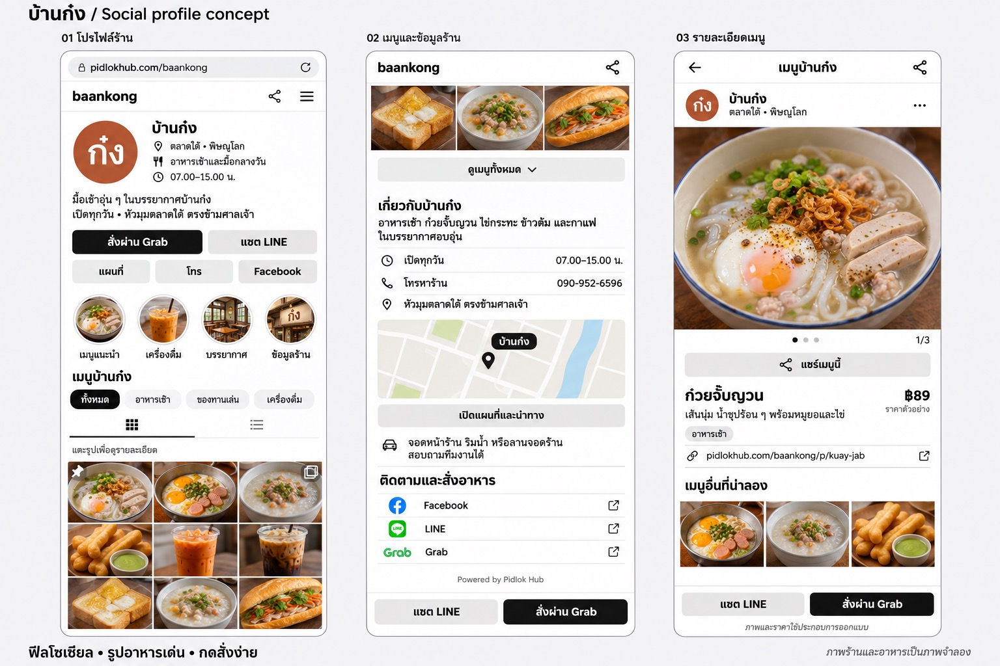
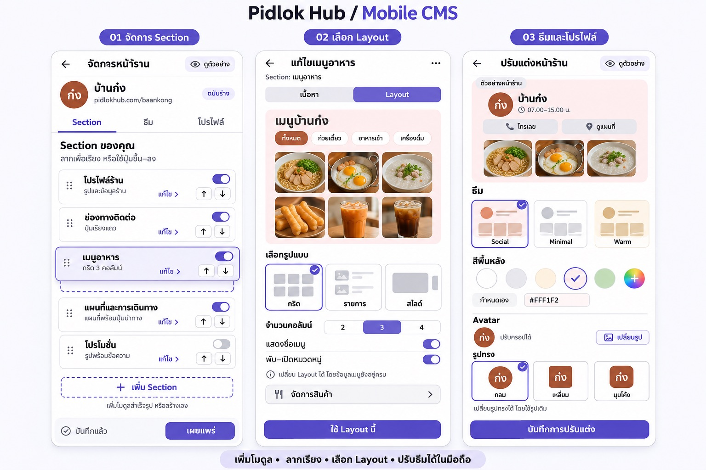

# Pidlok Hub — Product & Design Handoff

## แนวคิดและทิศทาง

- เว็บหน้าร้านสำหรับธุรกิจ เน้น Mobile-first ที่ `pidlokhub.com/businessname`
- รวมข้อมูลหลักใน Landing Page เดียว และเพิ่มหน้าแยกได้ตามระดับสมาชิก
- Mood & tone คล้ายโปรไฟล์ Instagram: เข้าใจเร็ว รูปเด่น ปุ่มชัด กดง่าย โดยมีเอกลักษณ์ของ Pidlok Hub
- ตัวอย่างธุรกิจ: บ้านก๋ง • ตลาดใต้ พิษณุโลก

## Section ของหน้าร้าน

แต่ละ Section ต้องมีหน้าที่ ขอบเขต และหัวข้อชัดเจน แยกอ่านง่ายบนมือถือ โดยไม่จำเป็นต้องตีกรอบทุกส่วน

1. Profile / Bio: Avatar ชื่อร้าน คำแนะนำ เวลาเปิด–ปิด และข้อมูลติดต่อ
2. Social Platforms: เลือกแพลตฟอร์ม ใช้โลโก้อัตโนมัติ สีประจำแพลตฟอร์ม และพยายามเปิดแอปเมื่อรองรับ แยกจากปุ่ม DIY ที่ตั้งชื่อ ลิงก์ ไอคอนและสีเองได้ เช่น ที่จอดรถและโทรหาร้าน
3. Shortcuts: ทางลัดไปยัง Section หรือหมวดสินค้า อาจใช้รูปแบบวงกลมคล้าย Highlights
4. Products: กริดรูปแบบ Instagram หมวดหมู่เลื่อนแนวนอน และการพับ–เปิดรายการ
5. Location: แผนที่ ปุ่มนำทาง ที่อยู่ และข้อมูลที่จอดรถ
6. Additional content: Section ที่ร้านสร้างเพิ่มเติม และหน้าแยกตามสิทธิ์สมาชิก

สินค้ากดเปิดรายละเอียด ดูรูปสไลด์ ชื่อ ราคา คำอธิบาย ปุ่มแชร์ และปุ่มติดต่อหรือสั่งซื้อได้ มีลิงก์ตรงไปยังสินค้าแต่ละรายการ

## CMS และการปรับแต่งหน้าร้าน

เจ้าของธุรกิจจัดการร้านของตัวเองผ่าน CMS ที่ใช้งานบนมือถือได้สะดวก พร้อมดูตัวอย่างก่อนเผยแพร่

### สีพื้นและธีม

- เลือกสีพื้นหลังหน้าร้านได้
- เปลี่ยนธีมสำเร็จรูปได้ โดยคงข้อมูลร้าน สินค้า และเนื้อหาเดิมไว้
- แยกการเลือกธีมออกจากเนื้อหา เพื่อเปลี่ยนหน้าตาโดยไม่ต้องกรอกข้อมูลใหม่
- สีข้อความและปุ่มต้องอ่านง่ายบนสีพื้นที่เลือก
- ธีมควรกำหนดภาพรวม เช่น สี ตัวอักษร รูปแบบปุ่ม และระยะห่าง ส่วนรายละเอียดแต่ละ Section ปรับแยกได้

### Avatar

- อัปโหลด เปลี่ยนรูป และปรับตำแหน่งครอป Avatar ได้
- เลือกทรงได้ 3 แบบ: วงกลม / สี่เหลี่ยม / สี่เหลี่ยมมุมโค้ง
- เปลี่ยนทรงได้โดยไม่ต้องอัปโหลดรูปใหม่

### Section แบบโมดูล

- แต่ละ Section เป็นโมดูลอิสระ เพิ่ม แก้ไข ลบ เปิด–ปิด และสลับลำดับได้
- ใน CMS แสดง Section เป็นการ์ดที่พับ–เปิดรายละเอียดได้ โดยแยกจากสวิตช์เปิด–ปิดการแสดงบนหน้าร้าน
- แต่ละการ์ดมีไอคอนใหญ่และสีประจำประเภท พร้อมการ์ดตั้งค่าซ้อนด้านใน แก้ไขเนื้อหาและ Layout ได้โดยตรง ไม่เปิด Popup เพิ่ม และมีปุ่มจัดลำดับ/ลบในส่วนรายละเอียด
- Sidebar บนเดสก์ท็อปใช้พื้นสีเทากลาง ตรึงตำแหน่งระหว่างเลื่อน และซ่อนเมื่อใช้จอมือถือ โดยใช้แท็บจัดการแทน
- จัดลำดับด้วยการลากวาง พร้อมปุ่มเลื่อนขึ้น–ลงสำหรับใช้งานบนมือถือ
- เลือกประเภท Section และรูปแบบการแสดงผลของแต่ละประเภทได้
- ตัวอย่างรูปแบบ: Social เป็นแถวปุ่มหรือปุ่มเต็มความกว้าง; Products เป็นกริด รายการ หรือสไลด์; Bio เป็นข้อความหรือรูปพร้อมข้อความ
- เปลี่ยนรูปแบบการแสดงผลได้โดยคงเนื้อหาที่รองรับร่วมกันไว้
- ตั้งชื่อหัวข้อของแต่ละ Section ได้ และจัดระยะห่างให้แยกส่วนชัดเจน
- ดูตัวอย่างการจัดเรียงจริงบนมือถือก่อนเผยแพร่

### DIY Section

- สร้าง Section เองจากบล็อกพื้นฐาน เช่น หัวข้อ ข้อความ รูปภาพ แกลเลอรี ปุ่ม และลิงก์
- เพิ่มและจัดลำดับบล็อกภายใน Section ได้
- เลือกรูปแบบจากตัวเลือกที่เตรียมไว้ แล้วปรับเนื้อหาและหน้าตาได้
- ไม่ต้องเขียนโค้ดเพื่อสร้าง Section ทั่วไป
- ขอบเขตตัวแก้ไข DIY และจำนวนรูปแบบเริ่มต้นต้องกำหนดก่อนพัฒนา

## สมาชิกและโมดูลในอนาคต

- สมัครและเข้าสู่ระบบด้วย Google SSO รองรับ Gmail และ Google Workspace
- ชำระค่าสมาชิก และกำหนดสิทธิ์ตามระดับ เช่น จำนวนสินค้า จำนวนหน้า และตัวเลือกการปรับแต่ง
- เพิ่มโมดูลการทำงานภายหลัง เช่น จองคิว นัดหมาย จองโต๊ะ และรับมัดจำ
- เมื่อธุรกิจเปิดใช้โมดูล ให้เพิ่ม Section หรือปุ่มบนหน้าร้าน และเมนูจัดการที่เกี่ยวข้องใน CMS
- แยกโมดูลเนื้อหา/การจัดหน้าออกจากโมดูลการทำงาน เช่น ระบบจอง เพื่อกำหนดสิทธิ์และต่อยอดได้สะดวก
- ราคาแพ็กเกจ สิทธิ์แต่ละระดับ และการคิดค่าบริการ Add-on ยังไม่ได้ข้อสรุป

## ข้อมูลตัวอย่างร้านบ้านก๋ง

- เปิดทุกวัน 07.00–15.00 น.
- หัวมุมตลาดใต้ พิษณุโลก มาจากริมน้ำผ่านไฟแดงคุณโจ ร้านอยู่ตรงข้ามศาลเจ้า
- จอดรถหน้าร้าน ริมน้ำ หรือลานจอดของร้าน สอบถามทีมงานได้
- โทร: 090-9526596
- Facebook: https://www.facebook.com/bankong.phitsanulok
- LINE: https://lin.ee/pb9F581
- Map: https://bit.ly/mapbaankong
- เมนู: https://shorturl.asia/T4XvR
- Grab: https://bit.ly/grabbaankong

ภาพหน้าร้าน ภาพอาหาร และราคาที่ใช้ในภาพออกแบบเป็นตัวอย่าง ต้องแทนด้วยข้อมูลที่ร้านยืนยันก่อนเผยแพร่จริง

## เกณฑ์ตรวจรับด้านการปรับแต่ง

- เปลี่ยนสีพื้นและธีมแล้วข้อมูลเดิมยังอยู่ครบ และอ่านได้ชัดบนมือถือ
- เปลี่ยน Avatar ได้ครบทั้งสามทรง โดยรูปไม่บิดเบี้ยว
- เพิ่ม ปิด และย้าย Section แล้วหน้าร้านแสดงตามลำดับที่ตั้งไว้หลังเผยแพร่
- เปลี่ยนรูปแบบ Section แล้วเนื้อหาที่รองรับร่วมกันยังอยู่ครบ
- สร้าง DIY Section ที่มีหัวข้อ ข้อความ รูป และปุ่มได้ พร้อมจัดลำดับบล็อกและดูตัวอย่างก่อนเผยแพร่
- การตั้งค่าของแต่ละธุรกิจไม่กระทบหน้าร้านธุรกิจอื่น

## ภาพอ้างอิงการออกแบบล่าสุด

ภาพเป็นแนวทางสำหรับพัฒนา ไม่ใช่ระบบที่เปิดใช้งานจริง ข้อกำหนดในเอกสารมีความสำคัญกว่าข้อความหรือรายละเอียดที่คลาดเคลื่อนในภาพจำลอง

### หน้าร้านบนมือถือ — Social profile

- โปรไฟล์กระชับ ปุ่มสั่งอาหาร แชต แผนที่ และติดต่อเข้าถึงง่าย
- วงกลมทางลัดคล้าย Highlights ใช้ไปยังหมวดหรือ Section
- กริดภาพสินค้า 3 คอลัมน์เป็นรูปแบบหลัก แตะเปิดรายละเอียดแบบโพสต์ พร้อมรูปสไลด์และปุ่มแชร์
- ไม่มีตัวเลขผู้ติดตาม ยอดไลก์ หรือรีวิวที่ไม่ได้มาจากข้อมูลจริง

### CMS บนมือถือ — จัดการโมดูลและหน้าตา

1. จัดการ Section: การ์ดโมดูลพร้อมลากเรียง ปุ่มขึ้น–ลง เปิด–ปิด แก้ไข และเพิ่มโมดูลหรือ DIY Section
2. เลือก Layout: แยกแท็บเนื้อหาและรูปแบบ มีตัวอย่างให้ดู เลือกกริด รายการ หรือสไลด์ พร้อมจำนวนคอลัมน์และตัวเลือกที่รองรับในแต่ละ Layout
3. ธีมและโปรไฟล์: เลือกธีม สีพื้นจากชุดสีหรือกำหนดเอง เปลี่ยนรูปและครอป Avatar เลือกกลม เหลี่ยม หรือมุมโค้ง

การบันทึกฉบับร่างต้องแยกจากการเผยแพร่จริง ปุ่มบันทึก/ใช้ Layout ในหน้าย่อยให้แก้ไขฉบับร่าง และใช้ปุ่มเผยแพร่ที่หน้าจัดการหลักเพื่อแสดงการเปลี่ยนแปลงบนหน้าร้าน มีปุ่มดูตัวอย่างก่อนเผยแพร่

ภาพ CMS ครอบคลุมหน้าจอหลัก ส่วนหน้าจอเลือกโมดูลและตัวแก้ไข DIY รายบล็อกยังต้องออกแบบเพิ่มเติม

## ข้อกำหนดเพิ่มเติม — ตัวแก้ไขแบบ Inline

- เปิดการ์ด Section แล้วแก้ไขเนื้อหาและ Layout ในการ์ดได้ทันที รวมการแก้รายการสินค้า Gallery และ DIY โดยไม่ต้องเปิด Popup ตัวแก้ไข
- เพิ่มโมดูลจากรายการภายในหน้าจัดการเดียวกัน
- เปลี่ยนชื่อเมนูตั้งค่าหน้าตาเป็น **ธีมแสดงผล**
- ธีมแสดงผลรองรับการเลือกรูปแบบฟอนต์และขนาดตัวอักษรทั้งหน้าร้าน โดยแยกฟอนต์เฉพาะชื่อ Top bar ได้
- แยก Social Platforms และปุ่ม DIY เป็นคนละโมดูล ตามข้อกำหนดด้านล่าง ทั้งสองแบบเพิ่ม ลบ เรียง และเปลี่ยนสีได้ แต่ Social ใช้ไอคอนแพลตฟอร์มอัตโนมัติ
- เพิ่ม Section **Top bar**: ใช้โลโก้ที่อัปโหลดหรือชื่อสำรอง เลือกฟอนต์เฉพาะจุด สีพื้น และปุ่มเมนูแบบจุดแนวนอนในวงกลม / ขีด / จุดแนวตั้งได้ เปิด–ปิดและย้ายลำดับได้เช่นเดียวกับโมดูลอื่น
- Sidebar ใช้เทากลาง เมนู Active และ Hover เป็นพื้นการ์ดธรรมดา ไม่มีเส้นเน้นด้านซ้าย
- ข้อมูลต้นแบบรุ่นก่อนเพิ่ม Top bar และปุ่มติดต่อเริ่มต้นให้อัตโนมัติ โดยคงเนื้อหา ธีม และลำดับ Section เดิมที่มีอยู่

## Social Platforms และปุ่ม DIY

### แยกเป็น 2 Section

1. **Social Platforms**: Facebook, Instagram, TikTok, Google Maps, YouTube, LINE, Grab และ LINE MAN รวม 8 แพลตฟอร์ม
2. **ปุ่ม DIY**: ปุ่มที่ร้านสร้างเอง เช่น ที่จอดรถ โทรหาร้าน จองโต๊ะ หรือรายละเอียดเพิ่มเติม

แต่ละ Section เปิด–ปิด ย้ายลำดับ และเลือก Layout แถวปุ่ม/เต็มแถวได้อิสระ โดยแยกจาก DIY Section ที่ใช้ประกอบข้อความ รูป และบล็อกเนื้อหา

### การตั้งค่า Social Platforms

- เลือกแพลตฟอร์มของแต่ละปุ่ม แล้วระบบเลือกไอคอนให้ ไม่ต้องมีช่องเลือกไอคอนเอง
- สีเริ่มต้นเป็นสีของแพลตฟอร์ม แต่เลือกสีอื่นได้ และมีปุ่มคืนสีประจำแพลตฟอร์ม
- เปลี่ยนแพลตฟอร์มแล้วใช้โลโก้และสีเริ่มต้นของแพลตฟอร์มใหม่ ส่วนข้อความที่ร้านเขียนเองและลิงก์เดิมยังคงอยู่ให้แก้ต่อ
- แก้ข้อความและลิงก์ เพิ่ม ลบ และเรียงปุ่มได้
- ลิงก์ไม่ตรงโดเมนแพลตฟอร์มให้แจ้งใน CMS และใช้ลิงก์เว็บปกติ ไม่สร้าง Deep Link ไปผิดแอป
- การเพิ่ม Instagram/TikTok/YouTube/LINE MAN ต้องกรอกลิงก์ร้านจริงเอง ไม่สร้างบัญชีหรือเดาลิงก์ให้ร้าน

### การเปิดแอปและเว็บสำรอง

- เปิดจากการกดของผู้ใช้เท่านั้น ไม่มีการเด้งเปิดแอปเองเมื่อโหลดหน้า
- Facebook, Instagram และ YouTube บน Chrome สำหรับ Android ใช้ HTTPS Intent ระบุแพ็กเกจแอป พร้อม `browser_fallback_url` เป็นเว็บเดิมเมื่อเปิดแอปไม่ได้
- iPhone/iPad และแพลตฟอร์มอื่นใช้ลิงก์ HTTPS เพื่อให้ Universal Links / App Links หรือผู้ให้บริการลิงก์จัดการเปิดแอป เมื่อไม่รองรับจึงยังเข้าถึงหน้าเว็บได้
- Google Maps ใช้ลิงก์ Maps แบบข้ามแพลตฟอร์ม ส่วน LINE, Grab, LINE MAN และ TikTok คงลิงก์ HTTPS/ลิงก์แชร์ของผู้ให้บริการ ไม่เดา Custom Scheme ที่ไม่มีเอกสารรองรับ
- ไม่ใช้ `line://` ซึ่ง LINE ประกาศเลิกแนะนำ ใช้ HTTPS แทน
- ภายในเบราว์เซอร์ของ Facebook/Instagram และ Android WebView ใช้ HTTPS เป็นทางเลือกสำรอง ไม่ฝืนเปิด Intent
- ไม่ใช้ Timer ตรวจว่าเปิดแอปสำเร็จหรือไม่ เพราะไม่สามารถตรวจการติดตั้ง/การเปิดแอปได้อย่างแน่นอน และอาจเปลี่ยนหน้าผิดจังหวะเมื่อกลับจากแอป
- พฤติกรรมขึ้นกับแอป เบราว์เซอร์ และค่าที่ผู้ใช้ตั้งไว้ ยังต้องทดสอบบนเครื่อง iPhone/Android จริง ทั้งมีและไม่มีแอป ก่อนเผยแพร่จริง
- ในต้นแบบ ไอคอนแพลตฟอร์มเป็น SVG ที่ฝังในไฟล์ ใช้งานออฟไลน์ได้ ควรตรวจชุดไฟล์แบรนด์และข้อกำหนดของแต่ละแพลตฟอร์มอีกครั้งก่อนเปิดบริการจริง

เอกสารอ้างอิง: [Chrome Android Intents](https://developer.chrome.com/docs/android/intents), [LINE URL schemes](https://developers.line.biz/en/docs/messaging-api/using-line-url-scheme/), [Google Maps URLs](https://developers.google.com/maps/documentation/urls/get-started), [Apple Universal Links](https://developer.apple.com/documentation/technotes/tn3155-debugging-universal-links)

### การตั้งค่าปุ่ม DIY

- ตั้งข้อความ ลิงก์ สี และเลือกไอคอนได้เอง รวมไอคอนรถสำหรับที่จอดรถ
- เพิ่ม ลบ และเรียงได้อิสระ ใช้ลิงก์ทั่วไป ไม่บังคับผูกกับแพลตฟอร์ม
- ตัวอย่างที่จอดรถในต้นแบบเชื่อม LINE เพื่อสอบถามทีมงาน ไม่ใช่พิกัดลานจอดที่ยืนยันแล้ว

### ย้ายข้อมูลจากต้นแบบเดิม

- แยกปุ่ม Social เดิมตามแพลตฟอร์มที่ตรวจพบ ส่วนปุ่มทั่วไปเก็บไว้ในปุ่ม DIY ตำแหน่งถัดกัน
- เก็บข้อความ ลิงก์ การแสดง/ซ่อน และสีที่ปรับเองไว้ สีที่ตรงกับค่าเริ่มต้นเก่าจะเปลี่ยนเป็นสีประจำแพลตฟอร์ม
- โหลดซ้ำแล้วไม่สร้าง Section หรือปุ่มซ้ำ และข้อมูลฉบับร่าง/ฉบับเผยแพร่ยังแยกกัน

## จำนวนคอลัมน์ของปุ่มในแต่ละ Section

- Social Platforms และปุ่ม DIY มีตัวเลือก **1 คอลัมน์ / 2 คอลัมน์** อยู่ในการ์ด Section
- ตั้งค่าแยกกันได้ เช่น Social Platforms 2 คอลัมน์ และปุ่ม DIY 1 คอลัมน์
- มีผลกับทุกปุ่มใน Section เดียวกัน ทั้งมือถือและตัวอย่างหน้าร้าน ไม่ตั้งค่าคอลัมน์เป็นรายปุ่ม
- แบบ 2 คอลัมน์ ทุกปุ่มมีความกว้างเท่ากัน หากจำนวนเป็นเลขคี่ ปุ่มสุดท้ายยังคงครึ่งแถว ไม่ขยายเต็มแถว
- ค่าเริ่มต้นสำหรับข้อมูลใหม่: Social Platforms 2 คอลัมน์ / ปุ่ม DIY 1 คอลัมน์
- ข้อมูลเดิมยังรักษา Layout ที่เลือกไว้: แถวปุ่มเดิมเท่ากับ 2 คอลัมน์ และเต็มแถวเดิมเท่ากับ 1 คอลัมน์

## Header และ Footer — โครงสร้างล่าสุด

ข้อกำหนดนี้แทนที่แนวทาง Top bar แบบ Section ที่ระบุไว้ก่อนหน้า

- เมนูหลักของ CMS: Header / จัดการ Section / Footer / ธีมแสดงผล / โปรไฟล์ร้าน บนมือถือใช้แท็บที่เลื่อนแนวนอนได้
- ย้าย Top bar ออกจากรายการ Section ไปเป็น Header ติดด้านบนระหว่างเลื่อน และคงการตั้งค่าโลโก้ ชื่อ ฟอนต์ สีพื้น การแชร์ และสไตล์เมนูเดิม เปิด–ปิดได้
- ย้ายข้อมูล Top bar เดิมอัตโนมัติ หากมีหลายรายการ เก็บค่ารายการเพิ่มเติมไว้ใน `legacyHeaders`
- Footer ติดด้านล่าง เปิด–ปิดได้ ค่าเริ่มต้นปิด และเลือกสีพื้นแถบได้
- Header และ Footer ไม่อยู่ในรายการเพิ่ม/ลบ/จัดลำดับ Section

### Footer แบบปุ่ม Social

- เลือก 1 หรือ 2 คอลัมน์ มีผลกับทุกปุ่มใน Footer
- ใช้ตัวแก้ไขแพลตฟอร์มและฟังก์ชันเปิดแอป/เว็บสำรองชุดเดียวกับ Section Social ครบ 8 แพลตฟอร์ม
- ตั้งข้อความ ลิงก์ สี เพิ่ม ลบ และเรียงได้ ข้อมูลแยกจาก Section Social

### Footer แบบเมนูไอคอน DIY

- สูงสุด 5 รายการในแถวเดียว จำนวนคอลัมน์เท่าจำนวนรายการ (1–5)
- ไอคอนด้านบน ข้อความด้านล่าง แต่ละรายการแก้ไอคอน ข้อความ และลิงก์ได้ พร้อมเพิ่ม ลบ และเรียง
- รองรับ URL ภายนอก โทร อีเมล และลิงก์ภายในหน้าร้าน เช่น `#section-products` และ `#section-location`
- ปิดปุ่มเพิ่มเมื่อครบ 5 รายการ และตรวจขีดจำกัดในฟังก์ชันเพิ่มด้วย
- สลับรูปแบบ Footer แล้วข้อมูลของทั้งสองแบบยังอยู่

### พื้นที่หน้าร้าน

- แสดง Header และ Footer เพียงชุดเดียว ติดขอบบน/ล่างของพื้นที่เลื่อนจริง รวมถึงตัวอย่างมือถือใน CMS
- รองรับ safe area ด้านล่างมือถือและการตัดบรรทัดข้อความในเมนูไอคอน
- Footer Social ที่มีปุ่มมากจำกัดความสูงและเลื่อนภายในได้
- Footer อยู่ในลำดับเอกสารด้วย เพื่อให้เข้าถึงเนื้อหาท้ายหน้าได้ เมื่อปิดไม่มีพื้นที่แถบเหลือค้าง
